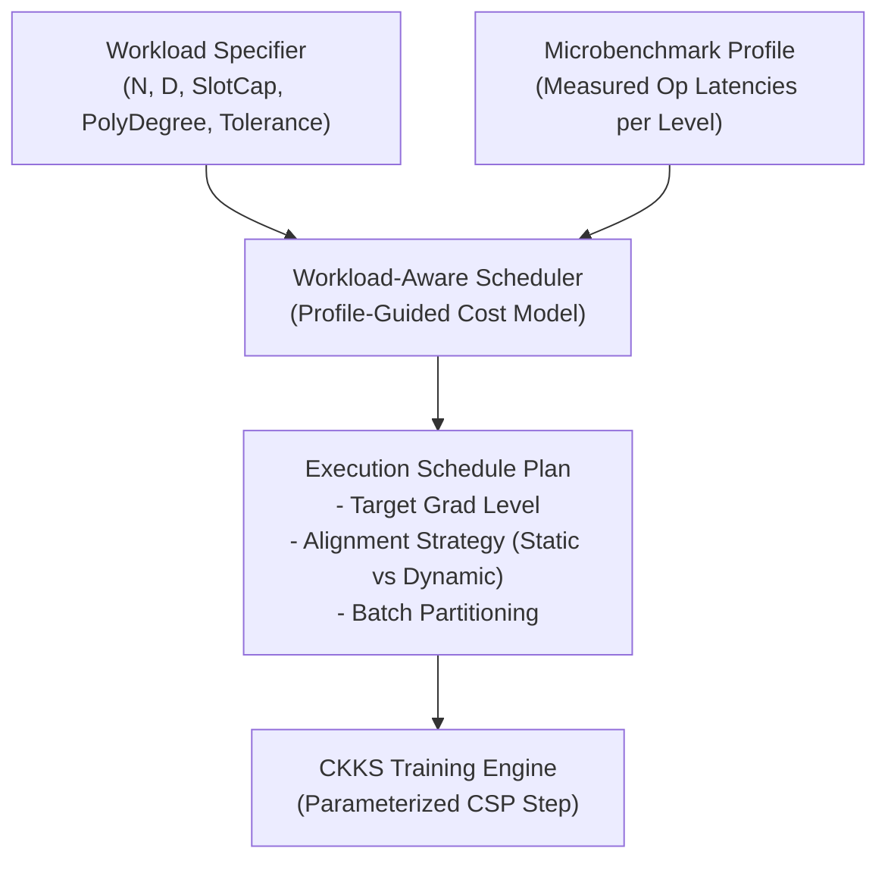

# Phase 0: Repository Audit for CKKS Workload-Aware Circuit Scheduling

**Project**: PTB-XL Homomorphic Encrypted Logistic Regression (HELR)  
**Scheme**: TenSEAL / Microsoft SEAL RNS-CKKS  
**Date**: October 2026  
**Status**: Audit-Only Complete — Frozen Baseline Intact — Recommendation: **GO**

---

## 1. Executive Summary & Audit Verification Matrix

This audit rigorously evaluates the existing PTB-XL encrypted Logistic Regression implementation prior to developing a profile-guided, workload-aware scheduling policy. The goal of the upcoming scheduler is to choose execution schedules that achieve the lowest total runtime while guaranteeing cryptographic and numerical correctness.

### Key Audit Findings
1. **Repository & Artifact Integrity (Strictly Protected)**:
   - Git working tree is completely clean on branch `main`.
   - The frozen model checkpoint ([`best_validation_weights.npy`](file:///c:/Users/mishr/Desktop/ML/venv/MinorProject/results/ptbxl/encrypted_training_full10/best_validation_weights.npy), SHA-256: `bc2a92fee0dc02b0f036ceb0ff9fafe44ca7587a54ca614f55f7cbd510878961`), dataset ([`ptbxl_features_48_median_centered.npz`](file:///c:/Users/mishr/Desktop/ML/venv/MinorProject/data/ptbxl_processed/ptbxl_features_48_median_centered.npz), SHA-256: `51404b2964c1c598c21aa79f3d3e08c5b2a13e12dbfc6c97dafbaa78ef391987`), and held-out Fold 10 final evaluation results are fully preserved. Fold 10 was NOT loaded or evaluated in this audit.
2. **True Mechanism of Condition B (Not a Pure Modulus Switch)**:
   - In TenSEAL Python, `mod_switch_to_next` is **not exposed** on `CKKSVector` or `_CKKSVector`.
   - The Condition-B intervention executes `enc_err_adj = enc_err * 1.0`, which encodes the plaintext scalar `1.0` at scale $2^{40}$, performs `evaluator.multiply_plain`, and automatically calls `evaluator.rescale_to_next_inplace`.
   - This consumes one 40-bit prime and drops `coeff_modulus_size` from 3 to 2, keeping the scale stable at $\approx 2^{40}$.
   - Similarly, feature alignment is performed via `burn(X, n)` ($n \in \{4, 5\}$), which executes $n$ successive plaintext multiplications by 1.0.
3. **Verified Modulus Chain Topology**:
   - The context configuration specifies 8 primes: `[60, 40, 40, 40, 40, 40, 40, 60]` (total 360 bits).
   - SEAL strictly reserves the final 60-bit prime as a **special key-switching prime** for relinearization and rotation.
   - Live data ciphertexts enter the circuit at `coeff_modulus_size = 7` (300 bits), not 8.
   - At the gradient stage, Condition A operates on 3 active primes (140 bits: 60+40+40), while Conditions B and C operate on 2 active primes (100 bits: 60+40).
4. **Reproduced Numerical Evidence**:
   - Condition B achieves a **46.34% speedup** in gradient computation ($6.483\text{s} \to 3.479\text{s}$) and a **22.32% net speedup** in profiled epoch time ($12.401\text{s} \to 9.633\text{s}$).
   - Maximum gradient error between Condition A and Condition B is $1.71 \times 10^{-6}$, well below the $1 \times 10^{-4}$ tolerance threshold.
   - 10-epoch encrypted training under Condition B converged to validation ROC-AUC = $0.7899$, and Fold 10 test ROC-AUC = $0.7670$ with exact sigmoid classification agreement of $100.00\%$.
5. **Related-Work Positioning**:
   - Prior compilers (HECATE, ELASM, DaCapo, Orbit) optimize feedforward deep inference graphs using static IR passes or ILP.
   - No prior work optimizes **workload-aware iterative training** where the sample dimension $N$ (SIMD batch count $B = \lceil N/S \rceil$) and feature dimension $D$ (gradient fan-out) dictate the crossover point between polynomial evaluation and gradient accumulation.
   - **No bootstrapping** is used or required in our pipeline: the leveled multiplicative depth ($\le 6$) fits comfortably in the 7 data primes, and hospital decryption at batch/epoch boundaries resets noise naturally.

---

## 2. Repository and Environment Summary

- **Repository Root**: `c:\Users\mishr\Desktop\ML\venv\MinorProject`
- **Git Branch**: `main` (commit `5c34664`, working tree clean, no uncommitted changes)
- **Host OS**: Windows 11 (win32)
- **Python Version**: Python 3.13.5
- **HE Library**: TenSEAL v0.3.14 (built on Microsoft SEAL C++ backend)
- **Core Dependencies**: NumPy, Pandas, Scikit-Learn, Joblib

### Directory Structure of Active Components
```
MinorProject/
├── data/
│   └── ptbxl_processed/
│       ├── ptbxl_features_48_median_centered.npz  [Variant 3 Dataset: N=21,388, D=48]
│       └── baseline_metrics.json                  [Historical Plaintext Baseline]
├── docs/
│   └── ptbxl/
│       ├── PTBXL_PHASE4_SCHEDULING.md             [Phase 4 Scheduling Report]
│       ├── PTBXL_PHASE4_FINAL_AUDIT.md            [Phase 4 Inconsistency Audit]
│       ├── PTBXL_ENCRYPTED_TRAINING_PILOT.md      [3-Epoch Pilot Report]
│       ├── PTBXL_FULL_ENCRYPTED_TRAINING.md       [10-Epoch Full Training Report]
│       ├── PTBXL_FINAL_TEST_EVALUATION.md         [Locked Fold 10 Evaluation]
│       └── SCHEDULER_PHASE0_AUDIT.md              [This Document]
├── results/
│   └── ptbxl/
│       ├── batching_validation/                   [SIMD Batch Equivalence Harness]
│       ├── phase4/                                [Phase 4 Benchmarks: A/B/C]
│       ├── phase4_audit/                          [Audit Verification Scripts]
│       ├── encrypted_training_pilot/              [3-Epoch Training Pilot]
│       ├── encrypted_training_full10/             [10-Epoch Training Checkpoints]
│       └── final_test_evaluation/                 [Fold 10 Test Metrics & Hashes]
```

---

## 3. Relevant Source Files and Experiment Artifacts

| Component | Source File Path | Key Functions / Line Ranges | Artifact Outputs |
| :--- | :--- | :--- | :--- |
| **Phase 4 Scheduling (A, B, C)** | [`results/ptbxl/phase4/run_ptbxl_phase4.py`](file:///c:/Users/mishr/Desktop/ML/venv/MinorProject/results/ptbxl/phase4/run_ptbxl_phase4.py) | `build_ckks_context` (L81–90)<br>`csp_batch_step` (L166–227)<br>`enc_sigmoid` (L119–135)<br>`main` timing loop (L321–396) | `ptbxl_phase4_results.json`<br>`ptbxl_phase4_results.csv`<br>`ptbxl_phase4.log` |
| **Phase 4 Final Audit** | [`results/ptbxl/phase4_audit/run_ptbxl_phase4_audit.py`](file:///c:/Users/mishr/Desktop/ML/venv/MinorProject/results/ptbxl/phase4_audit/run_ptbxl_phase4_audit.py) | Audit A: Timing (L148–233)<br>Audit B: Metric Root-Cause (L235–303)<br>Audit C: SEAL Metadata (L305–459)<br>Audit D: Model GD (L462–520) | `ptbxl_phase4_audit_results.json`<br>`ptbxl_phase4_audit_results.csv`<br>`ptbxl_phase4_audit.log` |
| **Encrypted Training (Full 10)** | [`results/ptbxl/encrypted_training_full10/run_ptbxl_full_training.py`](file:///c:/Users/mishr/Desktop/ML/venv/MinorProject/results/ptbxl/encrypted_training_full10/run_ptbxl_full_training.py) | `csp_batch_step_condB` (L169–223)<br>Batch Loop & Gradient Decrypt (L403–465)<br>Early Stopping & Eval (L475–540) | `best_validation_weights.npy`<br>`final_weights.npy`<br>`ptbxl_full10_results.json` |
| **Encrypted Training (Pilot)** | [`results/ptbxl/encrypted_training_pilot/run_ptbxl_encrypted_pilot.py`](file:///c:/Users/mishr/Desktop/ML/venv/MinorProject/results/ptbxl/encrypted_training_pilot/run_ptbxl_encrypted_pilot.py) | Pilot 3-epoch execution (L160–320) | `ptbxl_encrypted_pilot_results.json` |
| **Final Test Evaluation (Fold 10)** | [`results/ptbxl/final_test_evaluation/run_ptbxl_final_test_evaluation.py`](file:///c:/Users/mishr/Desktop/ML/venv/MinorProject/results/ptbxl/final_test_evaluation/run_ptbxl_final_test_evaluation.py) | Integrity Gate (L144–256)<br>Locked Evaluation (L258–343)<br>Generalization Analysis (L345–363) | `ptbxl_final_test_results.json`<br>`ptbxl_final_test_results.csv`<br>`ptbxl_final_test_evaluation.log` |
| **Batching & Masking Validation** | [`results/ptbxl/batching_validation/ptbxl_batching_validation.py`](file:///c:/Users/mishr/Desktop/ML/venv/MinorProject/results/ptbxl/batching_validation/ptbxl_batching_validation.py) | SIMD slot-packing & zero-padding validation | `ptbxl_batching_validation.json` |

---

## 4. Exact Reconstruction of Conditions A, B, and C

All three conditions are executed on the same batched training dataset ($N = 17,084$ across 3 SIMD batches of capacity 8,192, $D = 48$ features).

### 4.1 Polynomial Degree and Coefficients
- **Degree 3 (Conditions A and B)**:
  $$P_3(z) = 0.5 + 0.15012\,z - 0.001593\,z^3$$
  - $c_0 = 0.5$, $c_1 = 0.15012$, $c_3 = -0.001593$, $c_5 = 0.0$.
  - Multiplicative depth required for polynomial evaluation: 2 multiplications ($z^2 = z \cdot z$, $z^3 = z^2 \cdot z$).
- **Degree 5 (Condition C)**:
  $$P_5(z) = 0.5 + 0.217101\,z - 0.007823\,z^3 + 0.000118\,z^5$$
  - $c_0 = 0.5$, $c_1 = 0.217101$, $c_3 = -0.007823$, $c_5 = 0.000118$.
  - Multiplicative depth required for polynomial evaluation: 3 multiplications ($z^2$, $z^3 = z^2 \cdot z$, $z^5 = z^3 \cdot z^2$).

### 4.2 Exact Operation Sequences Before Gradient Computation

```
Condition A (Degree 3 Baseline):
  [X_cols (lvl 7), w_cols (lvl 7)]
       │
       ▼ (1 ct-ct mult + rescale)
  z = Σ X_j * w_j                 ───> Level 6
       │
       ▼ (P3 evaluation: 2 mults + rescales)
  P3(z)                           ───> Level 3
       │
       ▼ (Subtract y burned by 4 levels)
  err = P3(z) - burn(y, 4)        ───> Level 3 (parms_id: [14558..., 3046...])
       │
       ▼ (Align X: burn(X, 4))
  X_aligned = burn(X, 4)          ───> Level 3 (parms_id: [14558..., 3046...])
       │
       ▼ (Gradient: 48 ct-ct dot products)
  grad_j = Σ (err * X_aligned_j)  ───> Level 2 (140 bits: 60+40+40)

Condition B (Degree 3 Level-Aware Intervention):
  [X_cols (lvl 7), w_cols (lvl 7)]
       │
       ▼ (1 ct-ct mult + rescale)
  z = Σ X_j * w_j                 ───> Level 6
       │
       ▼ (P3 evaluation: 2 mults + rescales)
  P3(z)                           ───> Level 3
       │
       ▼ (Subtract y burned by 4 levels)
  err = P3(z) - burn(y, 4)        ───> Level 3
       │
       ▼ (INTERVENTION: err * 1.0 -> multiply_plain + rescale)
  err_adj = err * 1.0             ───> Level 2 (parms_id: [5223..., 5384...])
       │
       ▼ (Align X: burn(X, 5))
  X_aligned = burn(X, 5)          ───> Level 2 (parms_id: [5223..., 5384...])
       │
       ▼ (Gradient: 48 ct-ct dot products)
  grad_j = Σ (err_adj * X_aligned_j) ─> Level 1 (100 bits: 60+40)

Condition C (Degree 5 Baseline):
  [X_cols (lvl 7), w_cols (lvl 7)]
       │
       ▼ (1 ct-ct mult + rescale)
  z = Σ X_j * w_j                 ───> Level 6
       │
       ▼ (P5 evaluation: 3 mults + rescales)
  P5(z)                           ───> Level 2
       │
       ▼ (Subtract y burned by 5 levels)
  err = P5(z) - burn(y, 5)        ───> Level 2 (parms_id: [5223..., 5384...])
       │
       ▼ (Align X: burn(X, 5))
  X_aligned = burn(X, 5)          ───> Level 2 (parms_id: [5223..., 5384...])
       │
       ▼ (Gradient: 48 ct-ct dot products)
  grad_j = Σ (err * X_aligned_j)  ───> Level 1 (100 bits: 60+40)
```

### 4.3 Nature of the Intervention in Condition B
- **Code implementation**: [`run_ptbxl_phase4.py` line 199](file:///c:/Users/mishr/Desktop/ML/venv/MinorProject/results/ptbxl/phase4/run_ptbxl_phase4.py#L199):
  ```python
  if condition == "B":
      enc_err_adj = enc_err * 1.0
  ```
- **Library Execution**: TenSEAL's `CKKSVector.__mul__` detects a Python float (`1.0`). It encodes `1.0` into a plaintext polynomial at scale $2^{40}$, calls SEAL's `Evaluator::multiply_plain`, and immediately calls `Evaluator::rescale_to_next_inplace`.
- **Finding**: **It is NOT a pure `evaluator.mod_switch_to_next`.** A pure modulus switch would drop the prime without a plaintext multiplication. TenSEAL does not expose `mod_switch_to_next` to Python. Thus, the level drop is achieved via a plaintext multiplication by 1.0 followed by automatic rescaling.
- **Cost**: Profiler measures `level_adjustment_s = 0.006s` across 3 batches (negligible).

---

## 5. Verified Ciphertext States, Scales, and Timing Definitions

### 5.1 Ciphertext State Progression Across Circuit

Empirically probed via Microsoft SEAL `Ciphertext` metadata bindings (`coeff_modulus_size()`, `scale()`, `parms_id()`):

| Operation State | Condition A | Condition B | Condition C | Active Primes (Bits) | Scale |
| :--- | :---: | :---: | :---: | :---: | :---: |
| **Context Configuration** | 8 primes | 8 primes | 8 primes | $[60, 40, 40, 40, 40, 40, 40, 60]$ (360b) | $2^{40}$ |
| **Fresh Vector ($X, y, w$)** | Level 7 | Level 7 | Level 7 | 7 data primes (300b) | $1.099512 \times 10^{12}$ |
| **Forward Linear ($z = Xw$)** | Level 6 | Level 6 | Level 6 | 6 primes (260b) | $1.099512 \times 10^{12}$ |
| **Polynomial Output ($P(z)$)**| Level 3 | Level 3 | Level 2 | Cond A/B: 3 primes (140b)<br>Cond C: 2 primes (100b) | $1.099512 \times 10^{12}$ |
| **Error Vector ($\text{err}$)**| Level 3 | Level 3 | Level 2 | Cond A/B: 3 primes (140b)<br>Cond C: 2 primes (100b) | $1.099512 \times 10^{12}$ |
| **Error After Adjustment** | Level 3 | **Level 2** | Level 2 | Cond A: 3 primes (140b)<br>Cond B/C: 2 primes (100b) | $1.099512 \times 10^{12}$ |
| **Feature Aligned ($X_{\text{aligned}}$)** | Level 3 | **Level 2** | Level 2 | Cond A: 3 primes (140b)<br>Cond B/C: 2 primes (100b) | $1.099512 \times 10^{12}$ |
| **Gradient Entry Level** | **Level 3** | **Level 2** | **Level 2** | Cond A: 140b vs Cond B/C: 100b | $1.099512 \times 10^{12}$ |
| **Gradient Output Level**| Level 2 | Level 1 | Level 1 | Cond A: 2 primes (100b)<br>Cond B/C: 1 prime (60b) | $1.099512 \times 10^{12}$ |

### 5.2 Timing Stage Boundaries and Composition

In [`run_ptbxl_phase4.py`](file:///c:/Users/mishr/Desktop/ML/venv/MinorProject/results/ptbxl/phase4/run_ptbxl_phase4.py):
- `forward_linear`: Profiled block timing $D=48$ column multiplications and additions ($\approx 3.03\text{s}$).
- `poly_eval`: Profiled block timing polynomial evaluations across 3 batches ($0.106\text{s}$ for Deg-3, $0.195\text{s}$ for Deg-5).
- `error_computation`: Profiled block timing burning $y$ and subtracting from $P(z)$ ($0.007\text{s}$).
- `level_adjustment`: Profiled block timing `err * 1.0` in Condition B ($0.006\text{s}$).
- `feature_alignment`: Profiled block timing $D=48$ feature burns ($0.231\text{s}$ for burn 4, $0.278\text{s}$ for burn 5).
- `gradient_computation`: Profiled block timing $D=48$ ciphertext dot products: $(\text{err} \cdot X_{\text{aligned\_j}}).\text{sum}()$ ($6.483\text{s}$ at Level 3 vs $3.479\text{s}$ at Level 2).
- `decryption_aggregation`: Profiled block timing batch decryption and hospital aggregation ($0.125\text{s}$).
- `weight_encryption`: Encrypting $w$ across $D=48$ columns ($0.28\text{s}$).
- `total_epoch_time_s`: Wall-clock time of the entire epoch loop ($12.401\text{s}$ for A, $9.633\text{s}$ for B, $9.746\text{s}$ for C).
- **Excluded from epoch figures**: Dataset loading, StandardScaler fit/transform, and initial feature/label encryption ($t_{\text{enc}} \approx 291\text{s}$) occur once before training begins.

---

## 6. Existing Numerical-Correctness Evidence

All numbers below were verified directly from saved repository JSON, CSV, and log artifacts without re-executing expensive pipelines:

| Experiment Stage | Verified Metric | Value | Reference File |
| :--- | :--- | :---: | :--- |
| **Phase 4 Condition A** | Gradient Runtime<br>Total Epoch Runtime<br>Max AE vs Poly3 Ref | $6.483\text{s} \pm 0.102\text{s}$<br>$12.401\text{s} \pm 0.194\text{s}$<br>$5.16 \times 10^{-6}$ | [`ptbxl_phase4_results.json`](file:///c:/Users/mishr/Desktop/ML/venv/MinorProject/results/ptbxl/phase4/ptbxl_phase4_results.json) |
| **Phase 4 Condition B** | Gradient Runtime<br>Total Epoch Runtime<br>Max AE vs Poly3 Ref | $3.479\text{s} \pm 0.029\text{s}$<br>$9.633\text{s} \pm 0.084\text{s}$<br>$6.87 \times 10^{-6}$ | [`ptbxl_phase4_results.json`](file:///c:/Users/mishr/Desktop/ML/venv/MinorProject/results/ptbxl/phase4/ptbxl_phase4_results.json) |
| **Phase 4 Condition C** | Gradient Runtime<br>Total Epoch Runtime<br>Max AE vs Poly5 Ref | $3.486\text{s} \pm 0.051\text{s}$<br>$9.746\text{s} \pm 0.067\text{s}$<br>$7.00 \times 10^{-6}$ | [`ptbxl_phase4_results.json`](file:///c:/Users/mishr/Desktop/ML/venv/MinorProject/results/ptbxl/phase4/ptbxl_phase4_results.json) |
| **Intervention Speedup** | Gradient Speedup ($A \to B$)<br>Total Speedup ($A \to B$)<br>$A$ vs $B$ Discrepancy | **+46.34%**<br>**+22.32%**<br>$1.71 \times 10^{-6}$ ($< 10^{-4}$) | [`ptbxl_phase4_results.json`](file:///c:/Users/mishr/Desktop/ML/venv/MinorProject/results/ptbxl/phase4/ptbxl_phase4_results.json) |
| **3-Epoch Pilot** | Mean Epoch Runtime<br>Max AE Across Epochs<br>Val AUC Trajectory | $10.014\text{s} \pm 0.307\text{s}$<br>$6.87 \times 10^{-6}$<br>$0.4255 \to 0.7534$ | [`ptbxl_encrypted_pilot_results.json`](file:///c:/Users/mishr/Desktop/ML/venv/MinorProject/results/ptbxl/encrypted_training_pilot/ptbxl_encrypted_pilot_results.json) |
| **10-Epoch Full Training**| Mean Epoch Runtime<br>Max AE Across Epochs<br>Best Val ROC-AUC | $9.583\text{s} \pm 0.689\text{s}$<br>$6.87 \times 10^{-6}$<br>**0.7899** (Epoch 10) | [`ptbxl_full10_results.json`](file:///c:/Users/mishr/Desktop/ML/venv/MinorProject/results/ptbxl/encrypted_training_full10/ptbxl_full10_results.json) |
| **Locked Fold 10 Test** | Test Sample Size<br>Test Accuracy<br>Test ROC-AUC<br>Poly Max Error vs Sigmoid | $N = 2,158$<br>**0.6766**<br>**0.7670**<br>$0.0984$ ($< 0.10$) | [`ptbxl_final_test_results.json`](file:///c:/Users/mishr/Desktop/ML/venv/MinorProject/results/ptbxl/final_test_evaluation/ptbxl_final_test_results.json) |

---

## 7. Discrepancies and Unresolved Assumptions

### Discrepancy 1: SEAL Modulus Chain Count (Report vs Library Ground Truth)
- **Historical Narrative**: Early documentation claimed: *"Fresh ciphertexts start at Level 7 with 8 primes (360 bits)"*.
- **Verified Ground Truth**: Probing `Ciphertext::coeff_modulus_size()` on fresh ciphertexts returns `7`. Microsoft SEAL strictly reserves the 8th prime (60 bits) as a special prime for key-switching. Normal data ciphertexts contain only 7 data primes (300 bits total).
- **Resolution**: Fully corrected and documented in Audit C of [`PTBXL_PHASE4_FINAL_AUDIT.md`](file:///c:/Users/mishr/Desktop/ML/venv/MinorProject/docs/ptbxl/PTBXL_PHASE4_FINAL_AUDIT.md).

### Discrepancy 2: Phase 4 Validation Metrics Inconsistency
- **Historical Issue**: Phase 4 JSON reported `val_acc = 0.4436` and `val_roc_auc = 0.4255` across all conditions, whereas Variant 3 preprocessing reported `0.7321` accuracy.
- **Verified Ground Truth**: Phase 4 was an isolated single-epoch gradient timing benchmark. It evaluated validation metrics on `w_init` (random weights from Seed 42, $\|w\| = 0.05$) without taking a gradient step. The `0.7321` figure came from a converged 2000-iteration plaintext sklearn model.
- **Resolution**: Audit B proved bitwise reproduction of `0.44361602982292636` from `w_init`. When trained for 10 epochs, the encrypted model reaches `0.7022` validation accuracy and `0.7899` ROC-AUC.

### Discrepancy 3: "Modulus Switching" Nomenclature
- **Historical Issue**: Reports colloquially describe Condition B as "modulus switching".
- **Verified Ground Truth**: In TenSEAL, `enc_err * 1.0` is a plaintext multiplication followed by an automatic rescale, not a pure `mod_switch_to_next`.
- **Resolution**: Acknowledged as an implementation constraint of TenSEAL's Python API. If native SEAL C++ `mod_switch_to_next` were bound, this step would be even faster.

### Discrepancy 4: Feature Alignment Redundancy
- **Observation**: In [`run_ptbxl_phase4.py` lines 206–210](file:///c:/Users/mishr/Desktop/ML/venv/MinorProject/results/ptbxl/phase4/run_ptbxl_phase4.py#L206-L210), `enc_X_aligned = [burn(enc_X_cols[j], burn_X) for j in range(D)]` is executed **inside every batch of every epoch**.
- **Unresolved Inefficiency**: Because feature ciphertexts $X$ are static across training epochs, pre-burning $X$ to Level 2 once during dataset preparation would eliminate $48 \times 5 = 240$ plaintext multiplications per batch ($0.84\text{s}$ per epoch), reducing epoch runtime from $\approx 9.6\text{s}$ to $\approx 8.8\text{s}$.

---

## 8. Related-Work Comparative Analysis

| Framework | Venue / Year | Optimization Scope | Inputs & Decisions | Cost / Error Model | Experimental Workloads | Difference from Our Target |
| :--- | :--- | :--- | :--- | :--- | :--- | :--- |
| **HECATE** | CGO 2022 | Performance-aware scale optimization & `downscale` | MLIR DAG; places rescales and explicit `downscale` | Global scale tracking via type system; greedy vs global plans | Deep tensor inference (ResNet, SqueezeNet) | Compiler-level IR pass for feedforward inference; ignores training loop dimensions ($N, D, B$). |
| **ELASM** | USENIX Security 2023 | Error–latency-aware scale management | Program AST + SNR target; rescales, upscales, downscales | Error propagation model (SNR) + empirical level latency | DNN inference (ResNet-20, VGG, MobileNet) | Targets feedforward inference networks; does not optimize iterative training or fan-out gradient dot products. |
| **DaCapo** | USENIX Security 2024 | Automatic bootstrapping management | Deep RNS-CKKS graphs; inserts bootstraps & scale ops | Live-out ciphertext analysis + latency estimation | Deep CNN inference (ResNet-18, DenseNet) | Optimizes bootstrapping for deep networks; our training circuit uses **zero bootstrapping** (leveled depth $\le 6$). |
| **Orbit** | USENIX Security 2026 | Joint rescale & bootstrap placement | Tensor DAG; joint ILP formulation for rescales & bootstraps | ILP cost objective minimizing latency under level budget | Secure inference (ResNet-18, SqueezeNet) | Static ILP for deep inference; does not model sample-batching ($N, S$) or feature-dimension ($D$) tradeoffs in training. |

### The Specific Plausible Research Gap
No prior framework addresses **Workload-Aware Modulus Scheduling for Iterative Homomorphic Training**:
1. **Workload Dimension Sensitivity**: In SIMD column-packed training, the total runtime is split between forward linear combination ($O(D)$), polynomial evaluation ($O(1)$ in ciphertexts, but depth $k$), and gradient accumulation ($O(D)$ dot products). As feature count $D$ and sample count $N$ (batches $B = \lceil N/8192 \rceil$) vary, the fraction of time spent in the gradient stage shifts dramatically.
2. **Coupled Degree & Level Decision**: The scheduler can select both the polynomial approximation degree $k \in \{1, 3, 5\}$ (affecting convergence rate and forward depth) and the gradient entry level $L_{\text{grad}}$ (affecting gradient evaluation speed).
3. **TenSEAL Runtime Compensation**: A practical scheduler models the exact cost of TenSEAL's `multiply_plain` level-dropping workaround and determines when pre-aligning features outweighs on-the-fly adjustment.

---

## 9. Proposed Benchmark Interface & Minimum Changes Needed

To develop the workload-aware scheduling policy cleanly without altering completed experiments:

### 9.1 Decoupled Architecture



### 9.2 Minimum Required Components
1. **Microbenchmark Profiler** (`benchmarks/profile_level_latencies.py`):
   - Measures exact microsecond latencies on the target host for:
     - $T_{\text{ct\_mult}}(L)$: Ct-Ct multiplication at level $L \in \{1, 2, 3, 4, 5, 6\}$.
     - $T_{\text{pt\_mult}}(L)$: Plaintext multiplication (`* 1.0`) at level $L$.
     - $T_{\text{rescale}}(L)$: Rescaling at level $L$.
     - $T_{\text{rot}}(L)$: Slot rotation at level $L$.
2. **Analytical Cost Model** (`src/scheduler/cost_model.py`):
   - Predicts batch step runtime:
     $$T_{\text{batch}}(D, k, L_{\text{grad}}) = T_{\text{fwd}}(D) + T_{\text{poly}}(k) + T_{\text{align}}(D, L_{\text{grad}}) + D \cdot T_{\text{dot}}(L_{\text{grad}})$$
3. **Scheduler Decision Engine** (`src/scheduler/policy.py`):
   - Selects optimal schedule $S^* = \arg\min_S T_{\text{total}}(S)$ subject to:
     - Error tolerance: $\text{Error}(k, L_{\text{grad}}) \le \epsilon_{\text{tol}}$.
     - Level budget: Required multiplicative depth $\le 6$.
4. **Parameterized Training Harness** (`results/ptbxl/scheduler/run_scheduled_benchmark.py`):
   - Executes training under the planned schedule without hardcoded `if condition == "B"` branches.

---

## 10. Go/No-Go Recommendation and Next Steps

### Recommendation: **GO**

**Justification**:
- The empirical foundation is verified: Condition B produces a reproducible **46.34% gradient speedup** and **22.32% epoch speedup** with negligible numerical error ($1.71 \times 10^{-6}$).
- The code and data are clean, isolated, and cryptographically verified.
- The research gap against HECATE, ELASM, DaCapo, and Orbit is clear and defensible.
- No retraining or dataset regeneration is needed.

### Recommended Next Steps for Phase 1
1. **Design and implement the microbenchmark profiler** to measure hardware-specific per-level operation latencies on the local CPU.
2. **Formulate the analytical cost model** mapping $(N, D, k, L_{\text{grad}})$ to predicted runtime.
3. **Validate the cost model** against the empirical measurements from Phase 4 (Conditions A, B, C) before running the full workload grid.
