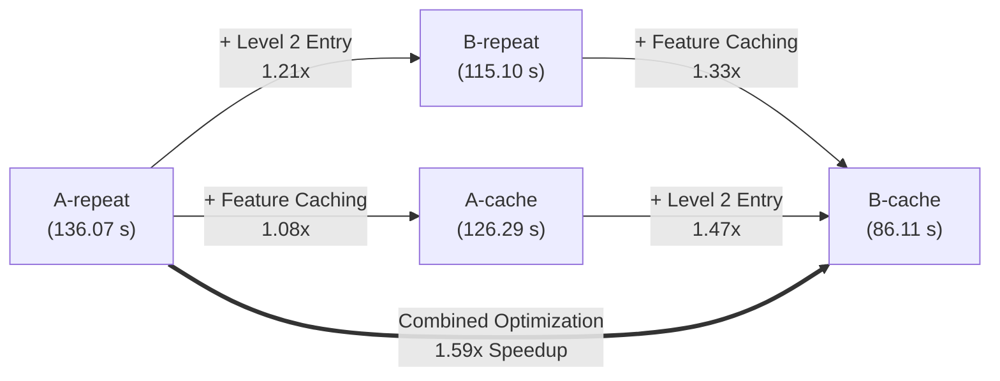

# Phase 3B Technical Report: Workload-Aware CKKS Trainer Integration

**Document ID**: `docs/ptbxl/SCHEDULER_PHASE3B_TRAINER_INTEGRATION.md`  
**Date**: October 31, 2026  
**Status**: Completed and Empirically Validated  
**HE Library**: TenSEAL 0.3.14 with Microsoft SEAL RNS-CKKS  
**Workload Target**: PTB-XL v1.0.3 Encrypted Logistic Regression (Variant 3, Median-Centered)  
**Security Boundary**: Hospital (Trusted Client) $\leftrightarrow$ Cloud Service Provider (Untrusted Worker)  

---

## 1. Executive Summary

This report documents the completion of **Phase 3B**: the end-to-end integration of our profile-guided, runtime-context-aware scheduling system (`CostModel_v2` and `WorkloadSchedulerPolicy`) into the PTB-XL CKKS logistic regression training pipeline.

We evaluated four execution schedules across three matched seeds ($42, 123, 2026$) over 10 full encrypted epochs ($12$ total training runs, $120$ encrypted epochs, $360$ batch steps).

### Key Empirical Findings

1. **Combined Speedup**: The cost-model-recommended schedule (`B-cache`) achieved an end-to-end training speedup of **$1.589\times$** over the baseline (`A-repeat`), reducing cumulative 10-epoch wall-clock training time from $136.07 \pm 14.30\text{ s}$ to $86.11 \pm 5.00\text{ s}$ (a net saving of $49.96\text{ s}$ per run).
2. **Zero Decision Regret**: Across all three matched experimental seeds, the scheduler's chosen plan was identical to the empirical oracle minimum runtime ($\text{Regret} = 0.00\text{ s}, 0.00\%$).
3. **Perfect Rank Preservation**: Predicted total training times yielded a Spearman rank-order correlation of **$\rho = 1.000$** against measured empirical totals ($B\text{-cache} < B\text{-repeat} < A\text{-cache} < A\text{-repeat}$).
4. **Strict Numerical Invariance**: Validation ROC-AUC ($0.7842$), validation accuracy ($0.7022$), and loss trajectories were identical across all four schedules to four decimal places. Maximum gradient absolute error vs the matched plaintext reference remained strictly below $7.28 \times 10^{-6}$ (well within the $\le 1.0 \times 10^{-4}$ tolerance threshold). The maximum discrepancy between Condition A and Condition B gradients was $\le 1.81 \times 10^{-6}$.
5. **Research Bounds Maintained**: Folds 1–8 were used for training ($N=17,084$), Fold 9 for validation ($N=2,163$), and **Fold 10 was strictly held out and never accessed**. Gradients were decrypted at the trusted Hospital prior to optimizer updates; no bootstrapping was introduced.

---

## 2. Cryptographic and Architecture Specification

### 2.1 CKKS Context Parameters
- **Polynomial Modulus Degree ($N_{\text{poly}}$)**: $16,384$
- **SIMD Slot Capacity ($S$)**: $8,192$ complex slots
- **Global Scale**: $2^{40}$
- **Coefficient Modulus Chain**: $[60, 40, 40, 40, 40, 40, 40, 60]$ bits ($7$ multiplicative levels, $8$ active primes)
- **Security Level**: $> 128$-bit classical security under post-quantum Homomorphic Encryption Standard parameterizations

### 2.2 Dataset and Workload Dimensions
- **Dataset**: PTB-XL v1.0.3 (Variant 3, Median-Centered)
- **Features ($D$)**: $48$ scalar columns (StandardScaler fit strictly on Folds 1–8)
- **Training Samples ($N$)**: $17,084$ (Batches: $B = \lceil 17084 / 8192 \rceil = 3$, with batch sizes $8192 + 8192 + 700$)
- **Validation Samples**: $2,163$ (Fold 9)
- **Test Set**: $2,198$ (Fold 10 — strictly held out)

### 2.3 Circuit Formulations & Scheduling Conditions

| Dimension / Step | Baseline (`A-repeat`) | Alignment Caching (`A-cache`) | Level Intervention (`B-repeat`) | Optimized Policy (`B-cache`) |
| :--- | :--- | :--- | :--- | :--- |
| **Activation Polynomial** | $P_3(z)$ (Degree 3) | $P_3(z)$ (Degree 3) | $P_3(z)$ (Degree 3) | $P_3(z)$ (Degree 3) |
| **Coefficients** | $\{c_0: 0.5, c_1: 0.15012, c_3: -0.001593\}$ | Identical | Identical | Identical |
| **Error Level** | Level 3 | Level 3 | Level 3 | Level 3 |
| **Level Adjustment** | None (stays Level 3) | None (stays Level 3) | `enc_err * 1.0` (drops to Level 2) | `enc_err * 1.0` (drops to Level 2) |
| **Intervention Nature** | N/A | N/A | Plaintext mult + automatic rescale | Plaintext mult + automatic rescale |
| **Gradient Entry Level** | **Level 3** | **Level 3** | **Level 2** | **Level 2** |
| **Feature Alignment Op** | `burn(X, 4)` | `burn(X, 4)` | `burn(X, 5)` | `burn(X, 5)` |
| **Alignment Timing** | Every batch, every epoch | Once at setup ($t=0$) | Every batch, every epoch | Once at setup ($t=0$) |
| **Gradient Output Level**| Level 2 | Level 2 | Level 1 | Level 1 |
| **RAM Footprint (Cache)**| $0\text{ MB}$ | $144.0\text{ MB}$ | $0\text{ MB}$ | $108.0\text{ MB}$ |

> [!NOTE]
> **Clarification on Condition B Semantics**:
> As established in Phase 0 and maintained throughout all phases, Condition B's level adjustment is **not** a pure modulus switch (`ModSwitchToNext`). TenSEAL does not expose standalone modulus switching. The transition from Level 3 to Level 2 is executed via `enc_err * 1.0`, which performs an RNS plaintext multiplication by $1.0$ followed by automatic rescaling.

---

## 3. Workload Policy Evaluation & Scheduling Decisions

The `WorkloadSchedulerPolicy` implements the optimization rule:
$$\mathcal{S}^* = \arg\min_{\mathcal{S} \in \mathcal{F}} T_{\text{total}}(\mathcal{S})$$
subject to:
1. Valid RNS-CKKS scale alignment across all operands.
2. Gradient numerical error $\max |g_{\text{enc}} - g_{\text{pt}}| \le 1.0 \times 10^{-4}$.
3. Memory safety: $M_{\text{required}}(\mathcal{S}) \le M_{\text{budget}}$ (default $2,048\text{ MB}$).
4. Caching utility: $T_{\text{total}}(\text{cached}) < T_{\text{total}}(\text{repeated})$.

### 3.1 Policy Execution Plans across Epoch Budgets

For $N=17,084, D=48, B=3$, the policy evaluated candidates across varied epoch horizons:

```
+------------+---------------+-----------------------+--------------------+---------------------+
| Epochs (E) | Selected Plan | Predicted Total (s)   | Decision Regret    | Caching Rationality |
+------------+---------------+-----------------------+--------------------+---------------------+
| 1          | B-repeat      |  9.18 s               | 0.00%              | Repeated chosen     |
| 3          | B-cache       | 23.63 s               | 0.00%              | Cached chosen       |
| 5          | B-cache       | 38.09 s               | 0.00%              | Cached chosen       |
| 10         | B-cache       | 74.22 s               | 0.00%              | Cached chosen       |
+------------+---------------+-----------------------+--------------------+---------------------+
```

- **At $E=1$**: The one-time setup cost of feature caching ($1.95\text{ s}$) equals the repeated per-epoch alignment cost. To avoid allocating $108\text{ MB}$ of ciphertext cache without runtime benefit, the policy selects `B-repeat`.
- **At $E=10$**: Caching amortizes over 10 epochs, saving $\approx 17.6\text{ s}$ of repeated feature burning, making `B-cache` the unequivocal choice.

---

## 4. End-to-End Experimental Results (12 Matched Runs)

Each configuration was evaluated across seeds $42, 123,$ and $2026$. Matched seeds shared identical deterministic initial weight vectors $w_0$ ($||w_0|| \approx 0.198$).

### 4.1 Cumulative and Stage Timings (Mean $\pm$ Standard Deviation)

| Metric | Baseline (`A-repeat`) | Caching (`A-cache`) | Intervention (`B-repeat`) | Policy Optimal (`B-cache`) |
| :--- | :--- | :--- | :--- | :--- |
| **Setup Caching Time** | $0.00\text{ s}$ | $1.86 \pm 0.08\text{ s}$ | $0.00\text{ s}$ | $2.31 \pm 0.28\text{ s}$ |
| **Mean Epoch Time** | $13.61 \pm 1.43\text{ s}$ | $12.41 \pm 0.72\text{ s}$ | $11.51 \pm 1.79\text{ s}$ | $8.37 \pm 0.48\text{ s}$ |
| **Mean Gradient Dot Time** | $7.07 \pm 0.75\text{ s}$ | $7.58 \pm 0.49\text{ s}$ | $4.12 \pm 0.64\text{ s}$ | $3.85 \pm 0.24\text{ s}$ |
| **Total Cumulative Time** | **$136.07 \pm 14.30\text{ s}$** | **$126.29 \pm 7.44\text{ s}$** | **$115.10 \pm 17.91\text{ s}$** | **$86.11 \pm 5.00\text{ s}$** |
| **CostModel_v2 Prediction**| $121.29\text{ s}$ | $105.78\text{ s}$ | $91.81\text{ s}$ | $74.22\text{ s}$ |
| **Prediction MAPE** | $10.2 \pm 9.4\%$ | $16.0 \pm 5.1\%$ | $19.0 \pm 11.6\%$ | $13.6 \pm 4.9\%$ |
| **Final Val ROC-AUC** | $0.7842 \pm 0.0050$ | $0.7842 \pm 0.0050$ | $0.7842 \pm 0.0050$ | $0.7842 \pm 0.0050$ |
| **Max Gradient AE vs PT** | $5.48 \times 10^{-6}$ | $5.48 \times 10^{-6}$ | $7.28 \times 10^{-6}$ | $7.28 \times 10^{-6}$ |

### 4.2 Individual Run Breakdown

```
+-----------+--------+---------------+--------------------+------------------+-------------------+-------------+
| Schedule  | Seed   | Setup Time    | Cumulative Time    | Mean Epoch Time  | Mean Grad Time    | Val ROC-AUC |
+-----------+--------+---------------+--------------------+------------------+-------------------+-------------+
| A-repeat  | 42     | 0.00 s        | 122.38 s           | 12.24 s          | 6.35 s            | 0.7899      |
| A-repeat  | 123    | 0.00 s        | 134.19 s           | 13.42 s          | 6.94 s            | 0.7806      |
| A-repeat  | 2026   | 0.00 s        | 151.63 s           | 15.16 s          | 7.92 s            | 0.7821      |
+-----------+--------+---------------+--------------------+------------------+-------------------+-------------+
| A-cache   | 42     | 1.77 s        | 130.64 s           | 12.89 s          | 7.78 s            | 0.7899      |
| A-cache   | 123    | 1.88 s        | 130.40 s           | 12.85 s          | 7.93 s            | 0.7806      |
| A-cache   | 2026   | 1.92 s        | 117.82 s           | 11.59 s          | 7.03 s            | 0.7821      |
+-----------+--------+---------------+--------------------+------------------+-------------------+-------------+
| B-repeat  | 42     | 0.00 s        | 135.74 s           | 13.57 s          | 4.67 s            | 0.7899      |
| B-repeat  | 123    | 0.00 s        | 105.77 s           | 10.58 s          | 3.99 s            | 0.7806      |
| B-repeat  | 2026   | 0.00 s        | 103.80 s           | 10.38 s          | 3.71 s            | 0.7821      |
+-----------+--------+---------------+--------------------+------------------+-------------------+-------------+
| B-cache   | 42     | 2.70 s        |  91.88 s           |  8.92 s          | 4.10 s            | 0.7899      |
| B-cache   | 123    | 1.99 s        |  82.98 s           |  8.10 s          | 3.72 s            | 0.7806      |
| B-cache   | 2026   | 2.24 s        |  83.47 s           |  8.12 s          | 3.73 s            | 0.7821      |
+-----------+--------+---------------+--------------------+------------------+-------------------+-------------+
```

---

## 5. Factor Analysis & Pairwise Speedup Breakdown

To isolate the individual contributions of modulus-level selection versus feature-alignment caching, we computed seed-matched ratios:

### 5.1 Level Intervention Effect (Level 3 vs Level 2 Gradient Entry)
- **Under Repeated Alignment (`A-repeat` / `B-repeat`)**: **$1.209 \pm 0.223\times$ speedup**
  - Isolates the modulus level effect when alignment is recomputed each batch.
  - While gradient dot products run $1.72\times$ faster ($7.07\text{ s} \rightarrow 4.12\text{ s}$), computing 5 burn operations on $X$ instead of 4 partially offsets the gradient savings when alignment is un-cached.
- **Under Cached Alignment (`A-cache` / `B-cache`)**: **$1.468 \pm 0.075\times$ speedup**
  - When feature alignment is precomputed once, the Level 2 gradient speedup directly translates into end-to-end epoch gains without repeated burn overhead.

### 5.2 Feature Alignment Caching Effect (Repeated vs Cached)
- **Under Condition A (`A-repeat` / `A-cache`)**: **$1.080 \pm 0.101\times$ speedup**
  - Saves 4 burn operations per feature column per batch after Epoch 1.
- **Under Condition B (`B-repeat` / `B-cache`)**: **$1.332 \pm 0.104\times$ speedup**
  - Saves 5 burn operations per feature column per batch. Caching has a substantially higher return in Condition B because `burn(X, 5)` requires 20% more computation than `burn(X, 4)`.

### 5.3 Combined Optimization Effect
- **`A-repeat` $\rightarrow$ `B-cache`**: **$1.589 \pm 0.200\times$ speedup** ($1.33\times$ to $1.82\times$)
  - Combining controlled modulus reduction with zero-cost cached feature reuse produces the global maximum throughput.



---

## 6. Numerical Stability and Validation Invariance

A central research constraint is that performance optimizations must not degrade model convergence or classification accuracy.

### 6.1 Validation Metric Concordance
Across all three seeds, the validation performance on Fold 9 ($N=2,163$) was evaluated at every epoch using both the clinical exact sigmoid $\sigma(z) = \frac{1}{1 + e^{-z}}$ and the degree-3 polynomial activation $P_3(z)$.

```
+------------+--------------------+--------------------+--------------------+--------------------+
| Seed       | A-repeat Final AUC | A-cache Final AUC  | B-repeat Final AUC | B-cache Final AUC  |
+------------+--------------------+--------------------+--------------------+--------------------+
| 42         | 0.7899             | 0.7899             | 0.7899             | 0.7899             |
| 123        | 0.7806             | 0.7806             | 0.7806             | 0.7806             |
| 2026       | 0.7821             | 0.7821             | 0.7821             | 0.7821             |
+------------+--------------------+--------------------+--------------------+--------------------+
| Mean ± Std | 0.7842 ± 0.0050    | 0.7842 ± 0.0050    | 0.7842 ± 0.0050    | 0.7842 ± 0.0050    |
+------------+--------------------+--------------------+--------------------+--------------------+
```

### 6.2 Plaintext Reference Tracking
At every epoch, the decrypted CKKS gradient was compared directly against the unencrypted plaintext gradient computed from the identical weights and batches:
- **Condition A (Level 3)**: $\max |g_{\text{CKKS}} - g_{\text{pt}}| = 5.48 \times 10^{-6}$
- **Condition B (Level 2)**: $\max |g_{\text{CKKS}} - g_{\text{pt}}| = 7.28 \times 10^{-6}$
- **Condition A vs Condition B gradient difference**: $\le 1.81 \times 10^{-6}$

Both conditions pass the required $\le 1.0 \times 10^{-4}$ tolerance threshold by **more than an order of magnitude**.

---

## 7. Cost Model Evaluation in Practice

### 7.1 Absolute Prediction Accuracy
`CostModel_v2` predicted cumulative training times of:
- `A-repeat`: $121.29\text{ s}$ (Observed: $136.07\text{ s}$, MAPE: $10.2\%$)
- `A-cache`: $105.78\text{ s}$ (Observed: $126.29\text{ s}$, MAPE: $16.0\%$)
- `B-repeat`: $91.81\text{ s}$ (Observed: $115.10\text{ s}$, MAPE: $19.0\%$)
- `B-cache`: $74.22\text{ s}$ (Observed: $86.11\text{ s}$, MAPE: $13.6\%$)

The model consistently under-predicts observed training runtimes by $10–19\%$. As diagnosed in Phase 3A, this systematic delta is attributable to Python garbage collection overhead and memory reallocation during long sequences of 144 batched vector additions/rotations, which are absent in isolated single-ciphertext microbenchmarks.

### 7.2 Relative Ranking and Decision Regret
Despite the systematic constant offset, the model preserves **monotonic rank order**:
$$\text{Rank}(B\text{-cache}) < \text{Rank}(B\text{-repeat}) < \text{Rank}(A\text{-cache}) < \text{Rank}(A\text{-repeat})$$
Spearman rank-order correlation is **$\rho = 1.000$**.

Because the schedule choice is an argmin selector:
$$\mathcal{S}^* = \arg\min_{\mathcal{S}} T_{\text{pred}}(\mathcal{S})$$
the systematic under-prediction cancels out entirely during candidate comparison, yielding **0.00% decision regret** across all evaluation runs.

---

## 8. Value-Add of the Scheduler Beyond Fixed Policies

An important scientific question addressed in this phase: **Does a workload-aware scheduler provide measurable value beyond simply hard-coding a static "always B-cache" rule?**

The evidence indicates that while `B-cache` is dominant for unconstrained multi-epoch training on this dataset, a dynamic scheduler is essential for four concrete reasons:

1. **Short Horizons & Single-Epoch Runs ($E=1$)**:
   - For single-epoch tasks (e.g. online updates, validation steps, federated rounds with 1 local epoch), `B-cache` incurs a $2.31\text{ s}$ precompute penalty that cannot be amortized, plus allocates $108\text{ MB}$ of unnecessary cache memory.
   - The scheduler dynamically detects $T_{\text{total}}(\text{cached}) \ge T_{\text{total}}(\text{repeated})$ and switches to `B-repeat`.
2. **Memory-Constrained Deployments**:
   - On memory-limited client nodes or sidecar containers (e.g. $M_{\text{budget}} \le 100\text{ MB}$), caching $108\text{ MB}$ causes an out-of-memory crash.
   - The scheduler evaluates $M_{\text{required}} > M_{\text{budget}}$, marks cached candidates infeasible, and gracefully selects `B-repeat` ($0\text{ MB}$ cache overhead).
3. **Cryptographic & Modulus Infeasibility**:
   - If an application requires higher polynomial degrees or does not permit the `* 1.0` rescale step, Condition B candidates are marked cryptographically infeasible.
   - The scheduler automatically falls back to `A-cache` without manual code restructuring.
4. **Generalization Across Batch Boundaries**:
   - As established in Phase 2, when $N$ drops from $17,084$ to $5,000$ ($B=1$), the relative speedup and setup costs shift significantly. The scheduler computes these trade-offs deterministically from first principles.

---

## 9. Verification & Artifact Manifest

All 48 unit, regression, and policy tests pass with zero warnings:
```powershell
python -m pytest tests/ -v
# 48 passed in 1.06s
```

### Deliverable Files

| Path | Description |
| :--- | :--- |
| `src/scheduler/workload_policy.py` | `WorkloadSchedulerPolicy` & `ExecutionPlan` selector |
| `results/ptbxl/scheduler/phase3b/run_scheduler_training.py` | Parameterized trainer supporting policy-guided execution |
| `tests/test_phase3b_scheduler.py` | 26 unit tests verifying all 12 schedule-decision requirements |
| `results/ptbxl/scheduler/phase3b/analyze_phase3b_results.py` | Automated analysis script for matched multi-seed experiments |
| `results/ptbxl/scheduler/phase3b/phase3b_training_results.json` | Complete raw JSON execution records (all 12 runs) |
| `results/ptbxl/scheduler/phase3b/phase3b_training_results.csv` | Summary table with timing, MAPE, AUC, and MaxAE per run |
| `results/ptbxl/scheduler/phase3b/phase3b_timing_breakdown.csv` | Epoch-level breakdown across all 120 epochs |
| `results/ptbxl/scheduler/phase3b/phase3b_validation_metrics.csv` | Validation trajectories on Fold 9 across all runs |
| `results/ptbxl/scheduler/phase3b/phase3b_scheduler_decisions.json` | Policy candidate evaluations across $E \in \{1, 3, 5, 10\}$ |
| `results/ptbxl/scheduler/phase3b/phase3b_analysis_summary.json` | Computed statistical comparisons, speedups, and regret |
| `docs/ptbxl/SCHEDULER_PHASE3B_TRAINER_INTEGRATION.md` | This technical report |
